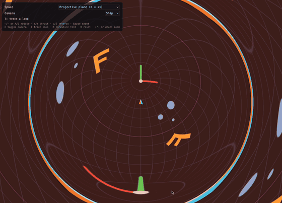

# Nonflatland

A small game for exploring two-dimensional spaces with different shapes and
geometries. You fly a spaceship around flat spaces like the torus and the
Klein bottle, curved ones like the sphere, the projective plane and a
hyperbolic double torus, and surfaces whose curvature changes from point to
point.

Everything is computed from the metric of the space, so the ship flies along
geodesics and you see what a two-dimensional inhabitant would see. You can
also trace a loop and watch it contract: it shrinks to a point if it can,
and otherwise gets stuck on the shortest closed geodesic it can reach.

Play it at [davazp.net/nonflatland](https://davazp.net/nonflatland).

